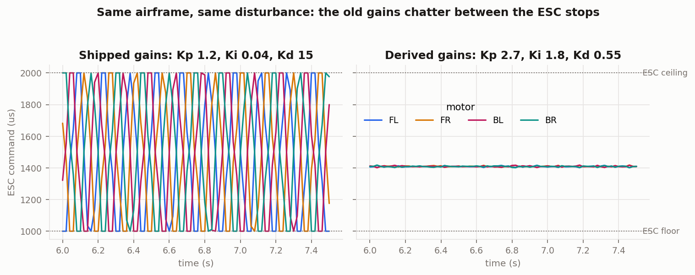

# Verification

How this firmware is checked, and what each layer can and cannot catch.

The organising idea is that **the control, estimation and safety logic contains
no Arduino dependency**. `attitude_ekf.h`, `pid_controller.h`, `mixer_math.h`,
`flight_state.h` and `can_telemetry.h` are arithmetic and state; hardware
access lives in thin wrappers that include them. That separation is what lets
the tests and the simulator link *the same source the flight controller runs*,
rather than a reimplementation of it. A control law verified in a separate
implementation has only been verified as a separate implementation, and the two
always drift.

## The layers

| Layer | What it runs | Catches | Runtime |
| --- | --- | --- | --- |
| Host unit tests | `firmware/test` | arithmetic, boundaries, state transitions, MAVLink framing | ~3 s |
| SIL | `firmware/sil` | closed-loop behaviour, stability, failsafes | ~3 s |
| HIL loopback | `firmware/sil --hil-loopback` | the HIL link: frames, units, signs, timeouts | ~3 s |
| MAVLink cross-check | `tools/mavlink_crosscheck.py` | anything pymavlink and our codec disagree on | ~2 s |
| HIL check | `simulator/tools/hil-check.mjs` | the browser simulator's side of HIL, against the firmware loop | ~2 s |
| Target build | `pio run` | anything that only fails on AVR or ESP32 | ~1 min |
| Bench HIL | the board and the simulator | the board's own timing and serial driver | not automated |
| Bench | a person | everything the model does not contain | not automated |

Every automated layer runs on every push.

## Host unit tests

```
cd firmware/test && make run
```

Plain `g++`, no dependencies. That is deliberate: a suite that needs a package
registry to be reachable stops running the first time that registry is down or
blocked, and a safety test nobody can run is not a safety test. The harness in
`test_harness.h` uses Unity's macro names, so the files drop into a PlatformIO
`pio test` setup unchanged if that is ever wanted.

Four suites, 90 tests. `make run` prints the count and the per-suite pass/fail, so the number here is checkable rather than asserted. It also compiles every header the board builds as C++11, because that is what the AVR toolchain uses and the suites themselves are C++17:

- **`test_control`** covers the PID and the mixer. Includes regression tests for
  a derivative kick on the first call after arming, a derivative filter whose
  cutoff moved with the loop rate, and an exhaustive sweep asserting no mix of
  any commands can put an output outside the ESC range.
- **`test_estimation`** covers the EKF against a synthetic truth trajectory.
  See [state_estimation.md](state_estimation.md).
- **`test_safety`** covers the arming gesture, every failsafe branch, the
  latch, and the CAN telemetry encoding.
- **`test_telemetry`** covers the MAVLink codec against bytes produced by
  pymavlink, the telemetry scheduler's rates and bandwidth, loop timing
  (including the `micros()` rollover), RC pulse decoding, and the HIL unit
  and sign conversions.

**This layer found a real defect.** `test_fault_on_ground_blocks_arming` failed
on first run: clearing the state on a fault was not enough on its own, because
the arm gesture was still being held and the next line walked straight back
into `ARMING`. An airframe with a flat battery would have armed. The fix is in
`flight_state.h` and the test is named after it.

## Software in the loop

```
cd firmware/sil && make run
```

Flies the control loop against a rigid body model: three-axis rotation with
inertia and aerodynamic damping, first-order motor lag, translation with linear
drag, per-motor thrust scaling, gyro bias, white noise on both sensors, and
receiver dropout. Nine scenarios, each with pass criteria:

| Scenario | Checks |
| --- | --- |
| `hover` | stays armed and level, actuators not on a rail |
| `gyro_bias` | 3 deg/s of bias is estimated to within 1 deg/s |
| `wind_disturbance` | a constant roll torque is rejected |
| `roll_step` | a 15 degree command is tracked |
| `motor_degraded` | one motor at 70 percent, airframe stays controlled |
| `signal_loss` | descends under control, does not cut power |
| `low_battery` | same, with the right fault reported |
| `imu_corruption` | garbage sensor data is detected and power is cut |
| `legacy_gains_rejected` | the pre-tuning gains are still rejected |

That last row is a scenario that **passes by failing**. If someone reintroduces
the old gains and the harness stops objecting, it turns red.

### What the model does not contain

Blade flapping, ground effect, propeller inflow, battery sag under load, ESC
nonlinearity, structural flex, wind gradients. This is a model good enough to
catch a sign error, an unstable gain, a windup bug or a failsafe that does not
fire. It is not good enough to predict flight time or to tune gains for a
specific airframe, and nothing here should be read as claiming otherwise.

### One loop, not two copies

The control sequence used to exist twice, in `main.cpp` and in the harness's
`Controller`, with a comment in each asking that they be kept in step. It now
lives once, in `flight_loop.h`, and `main.cpp`, the SIL harness and the HIL
build all call it. The extraction was checked by running all nine scenarios
and the 800 trial Monte Carlo campaign before and after it: every output file
is byte identical.

### Hardware in the loop

Built; see [hil.md](hil.md). `make hil-loopback` flies every scenario a
second time through the MAVLink bytes the HIL firmware exchanges with a
simulator, using the same `hil::Link` the board runs, and compares. Wherever
the receiver stays up, the two flights agree to better than 0.0001 degrees.

## What SIL found

The harness was written against the gains the firmware already shipped:
`Kp 1.2, Ki 0.04, Kd 15`. It rejected them.

Mean attitude looked acceptable, which is exactly what makes this failure mode
easy to miss. The actuators told the real story: with that derivative gain the
loop chased its own measurement noise and all four outputs chattered between
1000 and 2000 microseconds continuously, leaving no authority for a real
disturbance. A 30 percent loss on one motor put the airframe past 45 degrees
and into a failsafe cut within six seconds.



The criterion that caught it is in the harness: **more than 2 percent of steady
flight with any output sitting at an ESC limit is a failure**, however good the
attitude looks. Attitude staying small is not on its own evidence of a stable
loop.

The replacement gains are derived rather than guessed. For the modelled
airframe, one microsecond of roll command produces about 13.3 deg/s² of angular
acceleration, and the airframe contributes about 1.8 1/s of its own damping.
Treating the inner loop as second order:

```
omega_n^2      = 13.3 * Kp
2*zeta*omega_n = 13.3 * Kd + 1.8
```

Solving for `omega_n = 6 rad/s` and `zeta = 0.75` gives `Kp = 2.7` and
`Kd = 0.55`. `Ki = 1.8` follows from an integral time of about 1.5 s.

Measured results after the change:

| | Before | After |
| --- | --- | --- |
| Hover ESC range | 1000 to 2000 us | 1398 to 1419 us |
| Steady flight on a rail | continuous | 0 of 2796 samples |
| Roll RMS in hover | n/a, unstable | 0.11 deg |
| Roll step, 15 deg | not tracked | 15.0 deg, 15 percent overshoot, 0.38 s to 90 percent |
| One motor at 70 percent | past 45 deg in 6 s | peak 0.7 deg |

**These gains are tuned for the simulated airframe**, a 1 kg quad with a 0.15 m
arm and 6 N motors. They are a defensible starting point, not a substitute for
bench tuning on real hardware. Change the airframe and the derivation has to be
redone with its numbers.

## What HIL found

The loopback was expected to pass. It failed `signal_loss`: **losing the
receiver in flight cut the motors instead of landing.**

The state machine started its failsafe descent from the throttle on the step
the fault arrived (`land_throttle_ = in.throttle_norm`). Every RC receiver
driver, `receiver.h` included, reports zero throttle together with
`signal_lost`. So the descent started at zero, the next step reached the end
of the ramp, and the state machine went to `FAILSAFE_CUT` with the airframe
still in the air. On a real flight that is a drop from whatever height the
link died at.

Three layers had missed it, each for a reason worth knowing:

- The unit tests fed a lost-signal step that still carried throttle 0.6,
  which no receiver produces.
- The SIL scenario did the same: its scripted signal loss centred the sticks
  but left the throttle at hover.
- Nothing ran the real receiver's output through the real state machine.

The HIL path loses the link the way a real one is lost, by the overrides
simply stopping, and the board's link layer reports what a receiver reports.
That is what exposed it.

The fix starts the descent from the last throttle commanded while the link
was healthy (`flight_state.h`). The SIL scenario now models the receiver
honestly, the unit tests fly a healthy step before the loss, and
`test_signal_loss_from_real_receiver_still_lands` uses exactly the inputs the
receiver produces. Run against the old state machine, the SIL scenario, that
unit test and the simulator's HIL check all fail; against the new one they
pass, and every other scenario's output is unchanged byte for byte.

## What measuring the loop found

`config.h` says 250 Hz and every gain assumes it, but nothing measured it.
Reading the receiver code to wire up `loop_timing.h` showed it could not have
been true: `receiver.h` called `pulseIn()` on four channels in sequence, and
each call busy-waits for that channel's next pulse in a 20 ms frame. That is
several milliseconds per channel against a 4 ms budget, every cycle.

The receiver now timestamps edges in pin-change interrupts and decodes them
in `rc_pulse.h`, which is unit tested and keeps the old signal-loss policy
(hold the last sticks for 500 ms, then centre everything and close the
throttle). Reading four channels is now a constant-time copy. The board
reports its achieved period, jitter and missed deadlines over MAVLink, so the
250 Hz figure is something a ground station shows rather than something a
comment claims. `test_timing_flags_a_blocking_receiver` reproduces the old
receiver's timing and checks the monitor calls it what it is.

Bench numbers from a real board are the next thing to record here.

## Target build

`pio run` builds all three environments: `nano`, `esp32` and `esp32_hil`. It is the only layer that catches
AVR-specific and ESP32-specific problems: a missing `lib_deps` entry, a header
that exists on one core and not the other, or a global whose name collides with
something a core header declares.

Two ESP32 problems were found by reading rather than building, and are fixed:
`config.h` gave the ESP32 the Nano's pin numbers, and GPIO 6 to 9 on an ESP32
module are its SPI flash, so the first motor write would have stopped the chip;
and `battery.h` scaled the ADC for the Nano's 5 V, 10 bit converter, which on
the ESP32's 3.3 V, 12 bit one reads about six times the real voltage and would
never trip the low battery failsafe.

The collision below is not hypothetical either. Splitting the mixer arithmetic into a
`mixer` namespace collided with a global named `mixer` in `main.cpp`, and the
host tests could not see it because they never compile that file. The global is
now `motors`.

## Flight logs

Every SIL scenario writes a CSV to `firmware/sil/logs/`, plus a `.tlog` of the
MAVLink telemetry the board would have sent, which QGroundControl can replay.
CI keeps both as build artifacts. `tools/plot_flight_logs.py` turns them into the figures in the
README: estimate against truth, estimator health, the failsafe timeline, and
the actuator traces above.

Reading a flight log is most of what post-flight analysis is, so the logged
fields are chosen to support it rather than to look complete: truth and
estimate side by side, the bias estimate, the accelerometer innovation, all
four ESC commands, and the state machine's state and fault as integers.

## Running everything

```
cd firmware/test && make run            # unit tests, and the C++11 check
cd firmware/sil  && make run            # SIL scenarios, CSVs and .tlogs
cd firmware/sil  && make monte-carlo    # 800 randomised airframes
cd firmware/sil  && make hil-loopback   # every scenario through the HIL link
python3 tools/mavlink_crosscheck.py     # against pymavlink (pip install pymavlink)
cd simulator     && npm run hil-check   # the simulator's HIL side
cd groundstation && go test ./...       # the ground station
cd firmware      && pio run             # all three target builds
python3 tools/plot_flight_logs.py       # regenerate the figures
```
